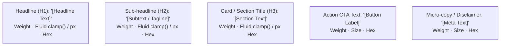

# Prompt Template: Generate Human-Readable Spec & UI Audit (`SCREEN_SPEC_XX_READABLE.md`)

> **File:** `PROMPTS/GENERATE_SCREEN_SPEC_READABLE.md`  
> **Role:** Principal UI/UX Auditor & Design Token Architect  
> **Target Output:** `specs/SCREEN_SPEC_[ID]_READABLE.md`  
> **Input Required:** Screenshot of the UI screen + Screen ID & Name (optional brand context)

---

## Agent Instructions

You are acting as the **Replica UI & Component Style Auditor**.
Analyze the attached visual screenshot and generate a structured, human-readable **UI & Component Style Inventory**. This document is formatted for designers, product managers, and frontend developers for rapid visual auditing and design system token extraction.

Your output must be saved to:  
`specs/SCREEN_SPEC_[ID]_READABLE.md`

---

## Output Contract & Required Sections

The generated file must adhere strictly to the following 5-part schema:

```markdown
# UI & Component Style Inventory: [Screen Name]

**File:** `SCREEN_SPEC_[ID]_READABLE.md`  
**Screen Target:** [Product / Screen Name]  
**Screen ID:** `[SCREEN-ID]` (e.g., `SCR-WEBEX-002`)  
**Companion File:** `specs/SCREEN_SPEC_[ID].md` (Code Generation Contract)  

---

## 1. Buttons & Interactive Elements Catalog

This catalog outlines every clickable button, navigation link, dropdown trigger, and interactive state visible on the screen.

### 1.1 Navigation & Action Buttons

| Button / Element | Visual Type | Position | Default Style | Hover & Active State | CSS / Implementation |
| :--- | :--- | :--- | :--- | :--- | :--- |
| **"[Button Label]"** | [Solid Pill / Ghost / Outline / Floating FAB] | [Header Right / Hero Center / Card Footer] | `background: #...`, text `#...`, height `...px`, padding `...`, `border-radius: ...`, font-size `...` | **Hover:** `background: #...`, cursor pointer<br/>**Active:** `transform: scale(0.98)` | `[Tailwind class string or CSS shorthand]` |

### 1.2 Navigation Links & Call-To-Actions

| Link Label | Variant | Destination / Role | Typography & Color | Hover State | Transition |
| :--- | :--- | :--- | :--- | :--- | :--- |
| **"[Link Text]"** | [Dropdown Nav Item / Header Link / Underline Link] | [Mega-menu trigger / Route / Modal] | [Size, Weight, Hex Color] | [Color shift, underline, chevron rotation] | `[Tailwind / CSS transition rule]` |

---

## 2. Headers & Typography Catalog

A complete architectural breakdown of all textual hierarchy across the viewport.

### Visual Hierarchy Flowchart


### 2.1 Typography Hierarchy Table

| Text Content | Tag / Role | Font Family | Size (Fluid / Responsive) | Weight | Line Height | Color / Treatment |
| :--- | :--- | :--- | :--- | :--- | :--- | :--- |
| **"[Headline Text]"** | `h1` (Hero Headline) | [Font Name] | `clamp(...)` (e.g., 40px – 64px) | 700 (Bold) | `1.1` | Solid `#ffffff`, `letter-spacing: -0.02em` |
| **"[Sub-headline]"** | `h2` / `p` (Lead Paragraph) | [Font Name] | `clamp(...)` (e.g., 20px – 28px) | 500 (Medium) | `1.3` | Solid `#cbd5e1` |
| **"[Card Heading]"** | `h3` (Card Title) | [Font Name] | `18px` | 600 (Semibold)| `1.4` | Solid `#f1f1f1` |
| **"[Button Label]"** | `span` (Button Text) | [Font Name] | `14px` | 600 (Semibold)| `1.2` | Solid `#ffffff` |
| **"[Disclaimer]"** | `small` (Micro-copy) | [Font Name] | `12px` | 400 (Regular) | `1.4` | Muted Silver Gray `#94a3b8` |

---

## 3. CSS System & Visual Tokens

### 3.1 Color Palette Tokens

| Token Name | Role / Category | Hex / RGBA Value | Sample Usage Context |
| :--- | :--- | :--- | :--- |
| `--color-bg-base` | Primary Canvas Background | `#0c0f12` | Viewport body & main shell |
| `--color-surface-elevated` | Elevated Card / Navbar | `#161b22` | Cards, popovers, dropdown containers |
| `--color-accent-primary` | Brand CTA / Emphasis | `#00875a` | Primary action buttons, active badges |
| `--color-text-primary` | High-contrast Text | `#ffffff` | Headlines, active links, primary labels |
| `--color-text-secondary` | Muted Secondary Text | `#94a3b8` | Subtext, timestamps, placeholders |
| `--color-border-subtle` | Dividers & Borders | `rgba(255, 255, 255, 0.08)` | Navbar bottom border, card outlines |

### 3.2 Visual Effects & Glassmorphism

- **Backdrop Filters:** `backdrop-filter: blur(16px)` on floating navigation and popovers.
- **Elevation Box Shadows:**
  - Card Shadow: `0 4px 20px rgba(0, 0, 0, 0.25)`
  - Glowing Button Shadow: `0 8px 24px rgba(0, 135, 90, 0.35)`
- **Ambient Radial Gradients:** Diffuse background glows (e.g., `radial-gradient(circle at 50% 0%, rgba(0, 135, 90, 0.15), transparent 70%)`).

---

## 4. Layout & Spacing Matrix

| Container / Section | Layout Model | Alignment | Paddings (T/R/B/L) | Gap | Max-Width |
| :--- | :--- | :--- | :--- | :--- | :--- |
| **Global Header** | Flex (Row) | `align-items: center; justify-content: space-between` | `0 32px` | `24px` | `100%` (Fixed height `68px`) |
| **Hero Container** | Flex (Row/Wrap) | `align-items: center; justify-content: space-between` | `80px 32px 64px` | `48px` | `1360px` centered |
| **Feature Card Grid** | Grid (`repeat(3, 1fr)`) | `stretch` | `0 32px` | `24px` | `1360px` centered |

---

## 5. Assets, Icons & Media Inventory

- **SVG Icons & Controls:**
  - `[Icon Name]` (e.g., Chevron, Search, Download, Close) — `16x16px` / `20x20px`, monochrome stroke/fill.
- **Images & Avatars:**
  - Avatar: `40x40px`, circular (`border-radius: 50%`).
  - Hero Mockup / Product Still: `16:9` ratio, rounded corners (`border-radius: 12px`).
- **Logos & Wordmarks:**
  - Brand Logo: Inline SVG or image asset, height `28px`.
```

---

## Quality Bar Checklist
- [ ] Are all visible buttons and links cataloged with both default and hover states?
- [ ] Is the typography table completely populated with fluid clamp() formulas and weights?
- [ ] Are all hex codes and CSS tokens explicitly mapped?
- [ ] Does the layout matrix detail Flex/Grid models, padding, and max-widths?
- [ ] Is the output saved directly to `specs/SCREEN_SPEC_[ID]_READABLE.md`?
