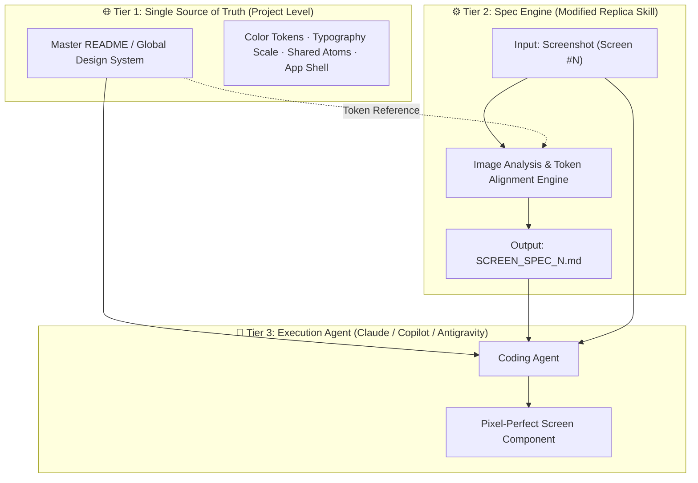

# Screen Specification Architecture & Multi-Screen Workflow Guide

> **A systematic blueprint for converting visual screenshots into deterministic, production-grade Screen Specifications for AI coding agents (Claude, Antigravity, GitHub Copilot).**

---

## 1. Executive Summary & Objective

### The Problem
When building multi-screen applications (30, 50, 100+ screens) using visual references (screenshots, Figma mocks):
- **Traditional AI prompts fail at scale**: Prompts are conversational, ambiguous, and subject to LLM interpretation.
- **Style Drift**: Screen #1 uses `#1a1a1a` and `16px` padding; by Screen #35, the LLM hallucinates `#121212`, `14px` padding, and arbitrary class names.
- **Context Window Bloat**: Feeding 30+ screens into a single AI prompt overloads the context window, causing hallucinations and omissions.

### The Solution: Deterministic Screen Specifications
Instead of generating a loose "developer prompt", we modify the **Replica** system into an **Automated Screen Spec Generator**. 

For every screen:
1. You provide the **Screenshot** of that screen.
2. The system outputs a high-fidelity **Screen Spec** (`SCREEN_SPEC_XX.md`) with **explicit, complete CSS rules**, DOM hierarchy, and interactive states.
3. The developer passes a **3-part triplet** to their coding agent (Claude, Antigravity, Copilot):
   - **Global Project Context** (Master README with shared design tokens & layout shell)
   - **Screen Spec** (Specific component & CSS rules for that exact screen)
   - **The Screenshot** (Visual ground truth for multimodal alignment)

This turns code generation from guesswork into a strict, verifiable contract.

---

## 2. Developer Prompt vs. Structured Screen Spec

| Dimension | Developer Prompt (Old Model) | Screen Specification (New Model) |
| :--- | :--- | :--- |
| **Primary Consumer** | Human pasting into Bolt/Lovable UI chat | Autonomous coding agent (Claude, Antigravity, Copilot) |
| **Output Format** | Conversational paragraph block | Strict, structured Markdown / YAML contract |
| **CSS Handling** | Suggestive (*"make it dark with a modern card shadow"*) | **Explicit & Complete** (exact CSS properties, hex values, flex/grid rules, transitions) |
| **Scalability (N Screens)** | Degrades rapidly (names and styles drift) | **Infinite** (each screen strictly references global tokens) |
| **Interactive States** | Frequently omitted | Explicitly mapped (`:hover`, `:active`, `:focus-visible`, transitions) |
| **Agent Error Rate** | 20% - 40% visual bugs | **< 3%** (agent simply implements the spec contract) |

---

## 3. The 3-Tier Scalable Architecture



### Tier 1: Global Context (`README.md` or `DESIGN_SYSTEM.md`)
Maintains all shared rules once, so they never need to be repeated across 100 screen specs:
- Brand color palette (primary, surfaces, borders, text tiers).
- Typography scale (font-family, sizes, weights, line heights).
- Global layout shells (TopNav, Mini-drawer, Main Sidebar, Footer).
- Shared atomic components (standard button variants, search bars, inputs).

### Tier 2: Screen Spec Generator (Replica Skill)
Takes any single screenshot and generates an isolated, deterministic screen specification. It maps visual elements to the global tokens from Tier 1 and extracts screen-specific layout and CSS.

### Tier 3: Agent Execution
When building Screen #42, the coding agent receives **only** Tier 1 + Spec #42 + Screenshot #42. The agent has 100% of the context it needs without any cross-screen clutter.

---

## 4. Standard Screen Spec Schema (The Output Contract)

Every generated screen spec adheres to the following standardized format:

```markdown
# Screen Spec: [Screen Name] (Screen #[ID])

## 1. Metadata & Route
- **Screen ID**: `SCR-[ID]`
- **Route**: `/example-route`
- **Shell Layout**: `AppLayout` (Full layout with sidebar collapsed / extended)
- **Viewport Target**: Desktop (1440px+), Tablet (768px - 1024px), Mobile (<768px)

## 2. Component & DOM Hierarchy
```html
<main class="screen-container">
  <div class="primary-column">
    <section class="media-player-wrapper">...</section>
    <header class="content-header">
      <h1 class="headline">...</h1>
      <div class="action-toolbar">...</div>
    </header>
    <section class="detail-card">...</section>
    <section class="comments-container">...</section>
  </div>
  <aside class="secondary-column">
    <div class="filter-chips-bar">...</div>
    <div class="recommended-cards-list">...</div>
  </aside>
</main>
```

## 3. Explicit CSS Specifications
*(All CSS values are exact. Global design tokens are referenced, and unique properties are written out in full.)*

```css
/* Layout Shell */
.screen-container {
  display: flex;
  flex-direction: row;
  gap: 24px;
  padding: 24px;
  background-color: var(--color-bg-base, #0f0f0f);
  color: var(--color-text-primary, #f1f1f1);
  min-height: calc(100vh - 56px);
}

.primary-column {
  flex: 1 1 0%;
  max-width: calc(100% - 424px);
  display: flex;
  flex-direction: column;
  gap: 16px;
}

.secondary-column {
  width: 400px;
  flex-shrink: 0;
  display: flex;
  flex-direction: column;
  gap: 16px;
}

/* Card / Surface Styles */
.detail-card {
  background-color: var(--color-surface-elevated, #272727);
  border-radius: 12px;
  padding: 16px;
  font-family: var(--font-body, 'Roboto', sans-serif);
  font-size: 14px;
  line-height: 20px;
  color: var(--color-text-primary, #f1f1f1);
}

/* Interactive Elements & States */
.action-btn-pill {
  display: inline-flex;
  align-items: center;
  gap: 6px;
  height: 36px;
  padding: 0 16px;
  border-radius: 18px;
  background-color: rgba(255, 255, 255, 0.1);
  font-size: 14px;
  font-weight: 500;
  color: #f1f1f1;
  border: none;
  cursor: pointer;
  transition: background-color 0.2s ease, transform 0.1s ease;
}

.action-btn-pill:hover {
  background-color: rgba(255, 255, 255, 0.2);
}

.action-btn-pill:active {
  transform: scale(0.98);
}
```

## 4. Typography & Color Mapping Table
| Element | Font Family | Size | Weight | Line Height | Color (Hex) |
| :--- | :--- | :--- | :--- | :--- | :--- |
| Video Title | Roboto | 20px | 700 (Bold) | 28px | `#f1f1f1` |
| Channel Name | Roboto | 16px | 500 (Medium) | 22px | `#f1f1f1` |
| Subscriber Count | Roboto | 12px | 400 (Regular) | 18px | `#aaaaaa` |
| Button Label | Roboto | 14px | 500 (Medium) | 20px | `#f1f1f1` |

## 5. Assets, Icons & Micro-Copy
- **Icons**: `ThumbsUp`, `ThumbsDown`, `Share2`, `Bookmark`, `MoreHorizontal` (Lucide React or SVG equivalents).
- **Images**:
  - Avatar: 40x40px, circular (`border-radius: 50%`).
  - Media Thumbnail: 16:9 ratio, rounded corners (`12px`).
- **Exact Text Labels**: `"Subscribe"`, `"Join"`, `"Share"`, `"Download"`, `"Save"`.

## 6. Responsive Breakpoints
- **Desktop (>1024px)**: 2-column layout (primary content + secondary sidebar).
- **Tablet & Mobile (<=1024px)**: Single-column stack (secondary column moves beneath primary column).
```

---

## 4.2 Companion Human-Readable Spec Schema (`SCREEN_SPEC_XX_READABLE.md`)

Alongside the technical code contract, the engine generates a structured UI & Design Audit specification formatted for designers, product managers, and visual inspection:

```markdown
# UI & Component Style Inventory: [Screen Name]
**File:** `SCREEN_SPEC_XX_READABLE.md`

## 1. Buttons & Interactive Elements Catalog
- Navigation & Action Buttons Table (Button Name, Visual Variant, Position, Default Style, Hover & Active States, CSS Classes)
- Text Links & Call-To-Actions (Label, Destination/Role, Typography, Color, Hover Transform)

## 2. Headers & Typography Catalog
- Hierarchical Table (Text Content, Semantic Tag h1/h2/p, Font Family, Fluid clamp() Formula, Font Weight, Line Height, Color/Gradient Hex stops)

## 3. CSS System & Visual Tokens
- Color Palette Tokens (Hex codes for background, surfaces, borders, text, accents)
- Visual Effects & Glassmorphism (Backdrop-filter blur values, shadows, radial glow layers)

## 4. Layout & Spacing Matrix
- Container & Section Table (Layout Model Flex/Grid, Alignments, Paddings, Gaps, Max Widths)

## 5. Assets, Icons & Media Inventory
- Categorized Tree (SVG icons with dimensions, thumbnails, avatars, hero media specifications)
```

---

## 5. Recommended Directory Layout for Any Number of Screens

Organize the repository so that screenshots, specs, and generated components follow a clean 1-to-1 matching convention:

```text
├── README.md                      # Master Project Spec & Global Design Tokens
├── SCREEN_SPEC_README.md          # This architecture and workflow guide
│
├── screenshots/                   # All raw visual references
│   ├── 01_home_feed.png
│   ├── 02_watch_player.png
│   ├── 03_channel_profile.png
│   └── ... (unlimited screens)
│
├── specs/                         # Generated Screen Specifications
│   ├── 01_home_feed.md
│   ├── 02_watch_player.md
│   ├── 03_channel_profile.md
│   └── ...
│
└── src/                           # Code generated by AI coding agents
    ├── components/
    │   ├── common/                # Shared atoms (Buttons, Navbar, Sidebar)
    │   └── screens/               # Screen-specific components
    │       ├── HomeFeed/
    │       ├── WatchPlayer/
    │       └── ChannelProfile/
```

---

## 6. End-to-End Workflow for Developers & Teammates

### Step 1: Initialize Global Context (Done Once)
Ensure `README.md` has the global tokens defined (colors, fonts, layout shell).

### Step 2: Spec Generation (Per Screen)
1. Drop the screenshot into `screenshots/screen_XX.png`.
2. Provide the screenshot to the Replica spec generator skill.
3. The spec generator produces `specs/screen_XX.md` with full CSS and DOM hierarchy.

### Step 3: Feeding into the AI Coding Agent (Claude, Antigravity, Copilot)
Send this exact prompt to the coding agent:

```text
You are building Screen #XX. 

Context provided:
1. Global design tokens and layout conventions in README.md
2. Screen specification in specs/screen_XX.md
3. Visual screenshot attached as image reference

Instructions:
- Implement the component exactly according to the CSS and DOM structure in specs/screen_XX.md.
- Use the shared design tokens from README.md.
- Ensure all interactive states (:hover, :active) and responsive rules are fully implemented.
- Do not invent any new styles outside the specification.
```

### Result
The coding agent has zero ambiguity. Because all CSS properties, layout hierarchies, and tokens are explicitly spelled out in the spec, the agent writes exact, production-ready code with no guesswork or visual defects.
