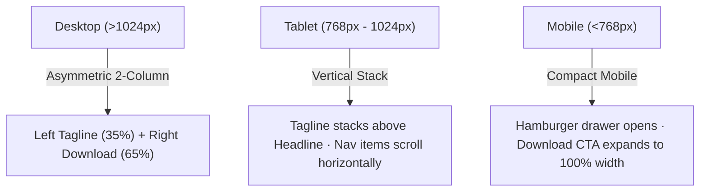

# Screen Spec: Webex Download Portal (SCR-WEBEX-002)

> **Specification Type:** Deterministic Screen Specification (Replica Engine v2.0)  
> **Target Route:** `/downloads`  
> **Source Reference:** Webex Official Client & Application Download Portal  
> **Design Aesthetic:** High-Contrast Dark Theme with Cisco Emerald Green CTA & Ambient Radial Diffuse Glow  
> **Companion Spec:** [`specs/SCREEN_SPEC_02_READABLE.md`](file:///c:/Users/RajdeepPurushottamPe/OneDrive%20-%20McLaren%20Strategic%20Solutions%20US%20Inc/Projects/.cursor/skills/Replica/specs/SCREEN_SPEC_02_READABLE.md)  

---

## 1. Metadata & Layout Architecture

- **Screen ID:** `SCR-WEBEX-002`
- **Route:** `/downloads`
- **Shell Layout:** `WebexDarkGlobalShell` (Fixed top navigation bar + dark immersive hero + clean contrast lower white canvas)
- **Viewport Target:**
  - Desktop: `1440px+` (Max content container `1360px` centered, 2-column hero split 35% / 65%)
  - Tablet: `768px - 1024px` (Header items collapse or scroll, hero stacks into single column)
  - Mobile: `<768px` (Navigation collapses to hamburger menu, download button stretches `100%` width, tagline centered above headline)

---

## 2. Component & DOM Hierarchy

```html
<div class="webex-app-root">
  <!-- 1. Global Navigation Bar (Height 68px, Obsidian Black #0c0f12) -->
  <header class="webex-global-header" role="banner">
    <div class="header-container">
      
      <!-- Left: Logo & Primary Navigation Links -->
      <div class="header-left-group">
        <a href="/" class="webex-brand-link" aria-label="Webex by Cisco Homepage">
          <!-- Webex Infinite Loop Multicolor SVG -->
          <svg class="webex-loop-icon" viewBox="0 0 34 26" width="34" height="26" aria-hidden="true">
            <defs>
              <linearGradient id="webex-loop-grad" x1="0%" y1="0%" x2="100%" y2="100%">
                <stop offset="0%" stop-color="#00d4ff" />
                <stop offset="50%" stop-color="#0066ff" />
                <stop offset="100%" stop-color="#9b00e8" />
              </linearGradient>
            </defs>
            <path fill="url(#webex-loop-grad)" d="M17 13c-3-4-7-6-11-6-4 0-6 3-6 6s2 6 6 6c4 0 8-2 11-6zm0 0c3 4 7 6 11 6 4 0 6-3 6-6s-2-6-6-6c-4 0-8 2-11 6z" />
          </svg>
          <div class="brand-text-block">
            <span class="brand-wordmark">webex</span>
            <span class="brand-descriptor">by CISCO</span>
          </div>
        </a>

        <!-- Main Navigation Links with Dropdown Triggers -->
        <nav class="primary-nav" aria-label="Primary Navigation">
          <ul class="nav-links-list">
            <li class="nav-item">
              <button class="nav-dropdown-btn" aria-expanded="false">
                <span>Products</span>
                <svg class="chevron-icon" viewBox="0 0 12 12" width="12" height="12"><path d="M2 4l4 4 4-4" fill="none" stroke="currentColor" stroke-width="1.8" stroke-linecap="round"/></svg>
              </button>
            </li>
            <li class="nav-item">
              <button class="nav-dropdown-btn" aria-expanded="false">
                <span>Devices</span>
                <svg class="chevron-icon" viewBox="0 0 12 12" width="12" height="12"><path d="M2 4l4 4 4-4" fill="none" stroke="currentColor" stroke-width="1.8" stroke-linecap="round"/></svg>
              </button>
            </li>
            <li class="nav-item">
              <button class="nav-dropdown-btn" aria-expanded="false">
                <span>Solutions</span>
                <svg class="chevron-icon" viewBox="0 0 12 12" width="12" height="12"><path d="M2 4l4 4 4-4" fill="none" stroke="currentColor" stroke-width="1.8" stroke-linecap="round"/></svg>
              </button>
            </li>
            <li class="nav-item">
              <button class="nav-dropdown-btn" aria-expanded="false">
                <span>Resources</span>
                <svg class="chevron-icon" viewBox="0 0 12 12" width="12" height="12"><path d="M2 4l4 4 4-4" fill="none" stroke="currentColor" stroke-width="1.8" stroke-linecap="round"/></svg>
              </button>
            </li>
            <li class="nav-item">
              <a href="/pricing" class="nav-link">Plans & Pricing</a>
            </li>
          </ul>
        </nav>
      </div>

      <!-- Right: Secondary Utility Links & Primary CTA -->
      <div class="header-right-group">
        <nav class="utility-nav" aria-label="Utility Navigation">
          <ul class="utility-links-list">
            <li class="utility-item"><a href="/download" class="utility-link active">Download</a></li>
            <li class="utility-item"><a href="/join" class="utility-link">Join a Meeting</a></li>
            <li class="utility-item"><a href="/signin" class="utility-link">Sign In</a></li>
            <li class="utility-item">
              <button class="region-selector-btn" aria-label="Select Region">
                <svg class="globe-icon" viewBox="0 0 16 16" width="16" height="16" fill="none" stroke="currentColor" stroke-width="1.5">
                  <circle cx="8" cy="8" r="7"/>
                  <path d="M1 8h14M8 1c2.5 2.5 3.5 5 3.5 7s-1 4.5-3.5 7c-2.5-2.5-3.5-5-3.5-7s1-4.5 3.5-7z"/>
                </svg>
                <svg class="chevron-icon" viewBox="0 0 10 10" width="10" height="10"><path d="M2 3.5l3 3 3-3" fill="none" stroke="currentColor" stroke-width="1.5"/></svg>
              </button>
            </li>
          </ul>
        </nav>
        <a href="/signup" class="btn-signup-pill">Sign Up, It's Free</a>
      </div>
    </div>
  </header>

  <!-- 2. Dark Hero Section with Emerald Ambient Glow -->
  <main class="webex-main-content">
    <section class="download-hero-section">
      <!-- Emerald Diffuse Radial Ambient Background Layer -->
      <div class="ambient-glow-layer" aria-hidden="true"></div>

      <div class="hero-content-container">
        <!-- Left Column: Editorial Tagline -->
        <div class="hero-left-column">
          <p class="hero-tagline">
            One platform,<br/>
            with all the<br/>
            ways<br/>
            to connect.
          </p>
        </div>

        <!-- Right Column: Download Headline & Primary Action -->
        <div class="hero-right-column">
          <h1 class="hero-main-title">Download Webex</h1>
          
          <div class="cta-action-wrapper">
            <a href="#download-exe" class="btn-download-pill" role="button">
              <span class="btn-text">For Windows (x64 and Arm64)</span>
              <svg class="download-tray-icon" viewBox="0 0 20 20" width="18" height="18" fill="none" stroke="currentColor" stroke-width="2.2" stroke-linecap="round" stroke-linejoin="round">
                <path d="M10 3v10M5 8l5 5 5-5M3 17h14"/>
              </svg>
            </a>
          </div>

          <!-- Micro-copy disclaimer & documentation link -->
          <div class="requirements-meta-row">
            <span class="req-notice-text">Requires Windows 10 or later.</span>
            <a href="/system-requirements" class="req-learn-more-link">Learn more</a>
          </div>
        </div>
      </div>
    </section>

    <!-- 3. Lower Content Section (Transition to White Canvas) -->
    <section class="lower-content-section">
      <div class="lower-content-container">
        <h2 class="lower-section-heading">Download</h2>
      </div>
    </section>
  </main>
</div>
```

---

## 3. Explicit CSS Specifications

```css
/* ==========================================================================
   Global Root Tokens
   ========================================================================== */
:root {
  --color-bg-header: #0c0f12;
  --color-bg-hero: #050807;
  --color-bg-white: #ffffff;

  --color-text-white: #ffffff;
  --color-text-dark: #0c0f12;
  --color-text-muted: #cbd5e1;
  --color-text-cisco: #94a3b8;

  --color-emerald-primary: #00875a;
  --color-emerald-hover: #00734c;
  --color-emerald-active: #005f3e;

  --font-sans: 'CiscoSans', -apple-system, BlinkMacSystemFont, 'Segoe UI', Roboto, Helvetica, Arial, sans-serif;
}

/* ==========================================================================
   Header Architecture
   ========================================================================== */
.webex-global-header {
  position: sticky;
  top: 0;
  left: 0;
  width: 100%;
  height: 68px;
  background-color: var(--color-bg-header);
  z-index: 1000;
  border-bottom: 1px solid rgba(255, 255, 255, 0.08);
}

.header-container {
  max-width: 1440px;
  height: 100%;
  margin: 0 auto;
  padding: 0 32px;
  display: flex;
  align-items: center;
  justify-content: space-between;
}

.header-left-group {
  display: flex;
  align-items: center;
  gap: 32px;
}

.webex-brand-link {
  display: flex;
  align-items: center;
  gap: 10px;
  text-decoration: none;
}

.brand-text-block {
  display: flex;
  flex-direction: column;
}

.brand-wordmark {
  font-family: var(--font-sans);
  font-size: 21px;
  font-weight: 700;
  color: var(--color-text-white);
  line-height: 1.1;
  letter-spacing: -0.02em;
}

.brand-descriptor {
  font-family: var(--font-sans);
  font-size: 9px;
  font-weight: 500;
  color: var(--color-text-cisco);
  letter-spacing: 0.06em;
  text-transform: uppercase;
}

.nav-links-list {
  display: flex;
  align-items: center;
  gap: 22px;
  list-style: none;
  margin: 0;
  padding: 0;
}

.nav-dropdown-btn {
  background: transparent;
  border: none;
  padding: 8px 0;
  font-family: var(--font-sans);
  font-size: 14px;
  font-weight: 400;
  color: var(--color-text-white);
  cursor: pointer;
  display: inline-flex;
  align-items: center;
  gap: 5px;
  transition: opacity 0.15s ease;
}

.nav-dropdown-btn:hover {
  opacity: 0.85;
}

.nav-link {
  font-family: var(--font-sans);
  font-size: 14px;
  font-weight: 400;
  color: var(--color-text-white);
  text-decoration: none;
  transition: opacity 0.15s ease;
}

.nav-link:hover {
  opacity: 0.85;
}

.header-right-group {
  display: flex;
  align-items: center;
  gap: 20px;
}

.utility-links-list {
  display: flex;
  align-items: center;
  gap: 20px;
  list-style: none;
  margin: 0;
  padding: 0;
}

.utility-link {
  font-family: var(--font-sans);
  font-size: 14px;
  color: var(--color-text-white);
  text-decoration: none;
  opacity: 0.9;
  transition: opacity 0.15s ease;
}

.utility-link:hover,
.utility-link.active {
  opacity: 1;
}

.region-selector-btn {
  background: transparent;
  border: none;
  color: var(--color-text-white);
  cursor: pointer;
  display: flex;
  align-items: center;
  gap: 4px;
  padding: 4px;
}

.btn-signup-pill {
  display: inline-flex;
  align-items: center;
  justify-content: center;
  height: 40px;
  padding: 0 20px;
  background-color: var(--color-text-white);
  color: var(--color-bg-header);
  font-family: var(--font-sans);
  font-size: 14px;
  font-weight: 600;
  border-radius: 9999px;
  text-decoration: none;
  transition: background-color 0.18s ease, transform 0.1s ease;
}

.btn-signup-pill:hover {
  background-color: #e2e8f0;
}

.btn-signup-pill:active {
  transform: scale(0.97);
}

/* ==========================================================================
   Hero Section Architecture & Emerald Ambient Glow
   ========================================================================== */
.download-hero-section {
  position: relative;
  background-color: var(--color-bg-hero);
  overflow: hidden;
  padding: 96px 48px 120px 48px;
  min-height: 520px;
}

.ambient-glow-layer {
  position: absolute;
  top: 0;
  right: 0;
  bottom: 0;
  left: 0;
  background: radial-gradient(
    circle at 76% 48%, 
    rgba(0, 135, 90, 0.28) 0%, 
    rgba(3, 33, 21, 0.20) 45%, 
    rgba(5, 8, 7, 0) 80%
  );
  pointer-events: none;
  z-index: 1;
}

.hero-content-container {
  position: relative;
  max-width: 1360px;
  margin: 0 auto;
  display: flex;
  align-items: flex-start;
  justify-content: space-between;
  gap: 60px;
  z-index: 2;
}

.hero-left-column {
  flex: 0 0 35%;
  max-width: 420px;
}

.hero-tagline {
  font-family: var(--font-sans);
  font-size: clamp(1.75rem, 3.2vw, 2.5rem);
  font-weight: 500;
  color: var(--color-text-white);
  line-height: 1.25;
  letter-spacing: -0.015em;
  margin: 0;
}

.hero-right-column {
  flex: 1 1 65%;
  max-width: 820px;
  display: flex;
  flex-direction: column;
  align-items: flex-start;
}

.hero-main-title {
  font-family: var(--font-sans);
  font-size: clamp(3.0rem, 6.0vw, 4.75rem);
  font-weight: 700;
  color: var(--color-text-white);
  line-height: 1.08;
  letter-spacing: -0.025em;
  margin: 0 0 36px 0;
}

/* ==========================================================================
   Primary Emerald Download CTA Pill
   ========================================================================== */
.btn-download-pill {
  display: inline-flex;
  align-items: center;
  justify-content: center;
  gap: 10px;
  height: 52px;
  padding: 0 28px;
  background-color: var(--color-emerald-primary);
  color: var(--color-text-white);
  font-family: var(--font-sans);
  font-size: 15px;
  font-weight: 600;
  border-radius: 9999px;
  text-decoration: none;
  box-shadow: 0 6px 18px rgba(0, 135, 90, 0.28);
  transition: background-color 0.2s cubic-bezier(0.16, 1, 0.3, 1),
              box-shadow 0.2s cubic-bezier(0.16, 1, 0.3, 1),
              transform 0.1s ease;
}

.btn-download-pill:hover {
  background-color: var(--color-emerald-hover);
  box-shadow: 0 8px 24px rgba(0, 135, 90, 0.45);
}

.btn-download-pill:active {
  transform: scale(0.98);
  background-color: var(--color-emerald-active);
}

.download-tray-icon {
  flex-shrink: 0;
}

/* ==========================================================================
   Requirements Micro-Copy
   ========================================================================== */
.requirements-meta-row {
  margin-top: 24px;
  display: flex;
  align-items: center;
  gap: 6px;
}

.req-notice-text {
  font-family: var(--font-sans);
  font-size: 14px;
  color: var(--color-text-muted);
}

.req-learn-more-link {
  font-family: var(--font-sans);
  font-size: 14px;
  color: var(--color-text-white);
  text-decoration: underline;
  text-underline-offset: 3px;
  transition: color 0.15s ease;
}

.req-learn-more-link:hover {
  color: #38bdf8;
}

/* ==========================================================================
   Lower Content Area (Pure White Canvas)
   ========================================================================== */
.lower-content-section {
  background-color: var(--color-bg-white);
  padding: 64px 48px 120px 48px;
}

.lower-content-container {
  max-width: 1360px;
  margin: 0 auto;
}

.lower-section-heading {
  font-family: var(--font-sans);
  font-size: clamp(2.5rem, 5.0vw, 3.5rem);
  font-weight: 700;
  color: var(--color-text-dark);
  margin: 0;
  letter-spacing: -0.02em;
}
```

---

## 4. Typography & Color Mapping Table

| UI Element | CSS Selector | Font Size | Weight | Line Height | Hex Color |
| :--- | :--- | :--- | :--- | :--- | :--- |
| **Hero Title** | `.hero-main-title` | `clamp(3.0rem, 6.0vw, 4.75rem)` | 700 (Bold) | `1.08` | `#ffffff` |
| **Hero Tagline** | `.hero-tagline` | `clamp(1.75rem, 3.2vw, 2.5rem)` | 500 (Medium) | `1.25` | `#ffffff` |
| **Download Button** | `.btn-download-pill` | `15px` | 600 (Semibold) | `1.00` | `#ffffff` |
| **Header Sign Up** | `.btn-signup-pill` | `14px` | 600 (Semibold) | `1.00` | `#0c0f12` |
| **Nav Links** | `.nav-dropdown-btn`, `.nav-link` | `14px` | 400 (Regular) | `1.20` | `#ffffff` |
| **Lower Heading** | `.lower-section-heading` | `clamp(2.5rem, 5.0vw, 3.5rem)` | 700 (Bold) | `1.15` | `#0c0f12` |
| **Requirement Text** | `.req-notice-text` | `14px` | 400 (Regular) | `1.40` | `#cbd5e1` |
| **Sub-brand Text** | `.brand-descriptor` | `9px` | 500 (Medium) | `1.00` | `#94a3b8` |

---

## 5. Assets, Icons & Micro-Copy

### 5.1 Inline SVGs
- **Download Arrow Tray Icon:** `18×18px`, stroke `#ffffff`, width `2.2`, tray base with centered downward arrow.
- **Globe Region Selector:** `16×16px`, outline wireframe circle with intersecting longitudinal/latitudinal curves.
- **Chevron Dropdown:** `12×12px` and `10×10px`, single-stroke down angle (`stroke-width: 1.8`).
- **Webex Infinite Loop Logo:** Multi-stop linear gradient from Cyan `#00d4ff` through Azure `#0066ff` to Magenta `#9b00e8`.

### 5.2 Micro-Copy Text Strings
- Main Action Button: `"For Windows (x64 and Arm64)"`
- Requirement Note: `"Requires Windows 10 or later. Learn more"`
- Header CTA: `"Sign Up, It's Free"`

---

## 6. Responsive Breakpoints & Motion Specification



### Motion Specifications (Framer Motion / CSS Transitions)
- **Hero Stagger Entrance:**
  - Initial: `opacity: 0, y: 24`
  - Animate: `opacity: 1, y: 0`
  - Duration: `0.6s`, Ease: `[0.16, 1, 0.3, 1]`
  - Stagger Children: `0.12s` (Tagline → Headline → CTA Pill → Micro-copy)
- **Button Micro-interactions:**
  - Hover: `background-color 0.2s ease`, shadow expansion
  - Active: `transform: scale(0.98)`
