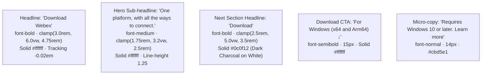

# UI & Component Style Inventory: Webex Download Portal
**File:** `SCREEN_SPEC_02_READABLE.md`  
**Screen Target:** Webex by Cisco — Official Download & Client Portal  
**Screen ID:** `SCR-WEBEX-002`  
**Companion File:** `specs/SCREEN_SPEC_02.md` (Code Generation Contract)  

---

## 1. Buttons & Interactive Elements Catalog

This catalog outlines every clickable button, navigation link, dropdown trigger, and interactive state visible on the screen.

### 1.1 Navigation & Action Buttons

| Button / Element | Visual Type | Position | Default Style | Hover & Active State | CSS / Implementation |
| :--- | :--- | :--- | :--- | :--- | :--- |
| **"Sign Up, It's Free"** | Solid White Pill Button | Global Header (Far Right) | `background: #ffffff`, text `#0c0f12`, height `38px`, padding `0 20px`, `border-radius: 9999px`, font-weight `600`, font-size `14px` | **Hover:** `bg-slate-200` (`#e2e8f0`), cursor pointer<br/>**Active:** `transform: scale(0.97)` | `bg-white text-[#0c0f12] text-sm font-semibold px-5 py-2 rounded-full hover:bg-slate-200 active:scale-95 transition-all duration-150` |
| **"For Windows (x64 and Arm64) ↓"** | High-Emphasis Emerald Action Pill | Hero Section (Directly under H1) | `background: #00875a`, text `#ffffff`, height `48px`, padding `0 26px`, `border-radius: 9999px`, font-weight `600`, font-size `15px`, inline icon gap `8px` | **Hover:** `background: #00734c`, subtle shadow `0 6px 20px rgba(0, 135, 90, 0.4)`<br/>**Active:** `transform: scale(0.98)` | `bg-[#00875a] hover:bg-[#00734c] text-white text-[15px] font-semibold px-7 py-3.5 rounded-full inline-flex items-center gap-2 shadow-lg shadow-[#00875a]/20 hover:shadow-[#00875a]/40 active:scale-98 transition-all` |
| **Language / Region Selector** | Icon + Dropdown Pill | Global Header (Pre-CTA) | Transparent background, 16×16px globe wireframe icon (`#ffffff`) + chevron `⌵`, gap `4px` | **Hover:** `opacity: 0.8`, cursor pointer<br/>**Active:** Opens region modal | `flex items-center gap-1 text-white opacity-90 hover:opacity-100 text-sm transition-opacity` |

---

### 1.2 Navigation Links & Call-To-Actions

| Link Label | Variant | Destination / Role | Typography & Color | Hover State | Transition |
| :--- | :--- | :--- | :--- | :--- | :--- |
| **"Products ⌵"** | Dropdown Nav Item | Mega-menu trigger | 14px, Regular (400), `#ffffff` | Color `#ffffff`, chevron rotates `180deg` or sub-menu opens | `text-sm text-white hover:text-slate-200 transition-colors` |
| **"Devices ⌵"** | Dropdown Nav Item | Mega-menu trigger | 14px, Regular (400), `#ffffff` | Color `#ffffff`, chevron rotates `180deg` | `text-sm text-white hover:text-slate-200 transition-colors` |
| **"Solutions ⌵"** | Dropdown Nav Item | Mega-menu trigger | 14px, Regular (400), `#ffffff` | Color `#ffffff`, chevron rotates `180deg` | `text-sm text-white hover:text-slate-200 transition-colors` |
| **"Resources ⌵"** | Dropdown Nav Item | Mega-menu trigger | 14px, Regular (400), `#ffffff` | Color `#ffffff`, chevron rotates `180deg` | `text-sm text-white hover:text-slate-200 transition-colors` |
| **"Plans & Pricing"** | Text Nav Link | Direct Route (`/pricing`) | 14px, Regular (400), `#ffffff` | Opacity `0.8` or subtle underline | `text-sm text-white hover:text-slate-300 transition-colors` |
| **"Download"** | Active Nav Item | Current Page (`/download`) | 14px, Medium (500), `#ffffff` | Permanent high-contrast active state | `text-sm text-white font-medium` |
| **"Join a Meeting"** | Text Action Link | Route (`/join`) | 14px, Regular (400), `#ffffff` | Color `#e2e8f0` | `text-sm text-white hover:text-slate-200 transition-colors` |
| **"Sign In"** | Text Action Link | Auth Route (`/signin`) | 14px, Regular (400), `#ffffff` | Color `#e2e8f0` | `text-sm text-white hover:text-slate-200 transition-colors` |
| **"Learn more"** | Inline Anchor Link | System Requirements link | 14px, Regular (400), `#ffffff`, underlined | Text decoration remains underlined, color shifts to `#38bdf8` or `#a7f3d0` | `text-sm text-white underline underline-offset-2 hover:text-emerald-300 transition-colors` |

---

## 2. Headers & Typography Catalog

A complete architectural breakdown of all textual hierarchy across the viewport.



### 2.1 Typography Hierarchy Table

| Text Content | Tag / Role | Font Family | Size (Fluid / Responsive) | Weight | Line Height | Color / Treatment |
| :--- | :--- | :--- | :--- | :--- | :--- | :--- |
| **"Download Webex"** | `h1` (Hero Headline) | Cisco Sans / Inter / system-ui | `clamp(3.0rem, 6.0vw, 4.75rem)` (48px – 76px) | 700 (Bold) | `1.08` | Solid `#ffffff`, `letter-spacing: -0.02em` |
| **"One platform, with all the ways to connect."** | `p` / `h2` (Tagline Left) | Cisco Sans / Inter / system-ui | `clamp(1.75rem, 3.2vw, 2.5rem)` (28px – 40px) | 500 (Medium) | `1.25` | Solid `#ffffff`, `letter-spacing: -0.01em` |
| **"Download"** *(Peeking section)* | `h2` (Next Section Title) | Cisco Sans / Inter / system-ui | `clamp(2.5rem, 5.0vw, 3.5rem)` (40px – 56px) | 700 (Bold) | `1.15` | High-contrast Dark Charcoal `#0c0f12` on pure white background |
| **"For Windows (x64 and Arm64)"** | `span` (Button Label) | Cisco Sans / Inter / system-ui | `15px` | 600 (Semibold) | `1.20` | Solid `#ffffff` |
| **"Requires Windows 10 or later."** | `span` (Disclaimer Micro-copy) | Cisco Sans / Inter / system-ui | `14px` | 400 (Regular) | `1.40` | Muted Silver Gray `#cbd5e1` |
| **"Learn more"** | `a` (Support Link) | Cisco Sans / Inter / system-ui | `14px` | 400 (Regular) | `1.40` | Solid `#ffffff` with persistent underline |
| **"webex"** | Logo Wordmark | Custom Geometric Sans | `22px` | 700 (Bold) | `1.00` | Solid `#ffffff` |
| **"by CISCO"** | Sub-brand descriptor | Cisco Sans / Inter | `10px` | 500 (Medium) | `1.00` | Light Gray `#94a3b8`, `letter-spacing: 0.05em` |
| **Global Navigation Items** | `a` / `button` | Cisco Sans / Inter | `14px` | 400 (Regular) | `1.20` | Solid `#ffffff` |

---

## 3. CSS System & Visual Tokens

### 3.1 Color Palette Tokens

```css
:root {
  /* Surface & Canvas Colors */
  --bg-header: #0c0f12;                /* Dark obsidian header bar */
  --bg-hero: #050807;                  /* Dark hero canvas */
  --bg-section-light: #ffffff;         /* Pure white lower content block */
  
  /* Brand Accent & Action Colors */
  --color-brand-emerald: #00875a;      /* Webex primary action green */
  --color-brand-emerald-hover: #00734c;/* Emerald hover state */
  --color-cta-white: #ffffff;          /* Header Sign Up button surface */
  --color-cta-white-hover: #e2e8f0;    /* Header Sign Up hover surface */

  /* Text & Micro-copy Colors */
  --text-primary-dark: #ffffff;        /* High-contrast white for dark hero */
  --text-secondary-dark: #cbd5e1;      /* Slate-300 for disclaimers */
  --text-primary-light: #0c0f12;       /* Charcoal for white section */
  --text-brand-muted: #94a3b8;         /* 'by CISCO' descriptor */

  /* Logo Gradient Stops */
  --webex-loop-cyan: #00d4ff;
  --webex-loop-blue: #0066ff;
  --webex-loop-magenta: #9b00e8;

  /* Ambient Glow Token */
  --hero-ambient-glow: radial-gradient(
    circle at 78% 48%, 
    rgba(0, 135, 90, 0.28) 0%, 
    rgba(3, 33, 21, 0.20) 45%, 
    rgba(5, 8, 7, 0) 80%
  );
}
```

### 3.2 Visual Effects, Glassmorphism & Radii

* **Hero Ambient Radial Glow:**  
  `background: radial-gradient(circle at 75% 50%, rgba(0, 135, 90, 0.25) 0%, rgba(4, 28, 18, 0.15) 50%, #050807 85%);`
* **CTA Button Elevation Shadow:**  
  `box-shadow: 0 4px 14px rgba(0, 135, 90, 0.28);`
* **Pill Border Radii:**  
  `border-radius: 9999px;` (Used uniformly across Header Sign-Up and Hero Download buttons).
* **Section Border Separation:**  
  Seamless clean edge transition from `#050807` to `#ffffff` without hard borders.

---

## 4. Layout & Spacing Matrix

| Container / Section | Layout Model | Alignment & Flow | Padding & Margin | Dimensions / Max Width |
| :--- | :--- | :--- | :--- | :--- |
| **Global Header** | CSS Flexbox | `justify-between`, `items-center` | Height `68px`, Padding `0 32px` | Full viewport width (`100%`) |
| **Header Left Group** | CSS Flexbox | `items-center`, `gap: 24px` | Margin `0` | Auto (`flex-shrink: 0`) |
| **Header Right Group** | CSS Flexbox | `items-center`, `gap: 20px` | Margin `0` | Auto (`flex-shrink: 0`) |
| **Hero Container** | CSS Grid / 2-Column Flex | `items-center`, `justify-between` | Padding `100px 48px 120px 48px` | Max width `1360px` centered (`margin: 0 auto`) |
| **Hero Left Column (Tagline)** | Flex Column | `items-start`, `justify-center` | Padding-right `40px` | Width `35%` (`max-width: 400px`) |
| **Hero Right Column (Download)**| Flex Column | `items-start`, `gap: 24px` | Padding-left `20px` | Width `65%` (`max-width: 820px`) |
| **Requirement Row** | Inline Flex | `items-center`, `gap: 6px` | Margin-top `8px` | Fits content |
| **White Content Section** | Block / Container | `items-start` | Padding `72px 48px` | Full viewport width (`100%`) |

---

## 5. Assets, Icons & Media Inventory

### 5.1 Icon Library Specifications

| Icon Name | Category | Recommended Library | Dimensions | Color | Notes |
| :--- | :--- | :--- | :--- | :--- | :--- |
| **`Download` (Arrow Down)** | Action Icon | Lucide: `ArrowDown` / `Download` | `18×18px` | `#ffffff` | Embedded inside the emerald Windows download pill |
| **`ChevronDown`** | Navigation Icon | Lucide: `ChevronDown` | `14×14px` | `#ffffff` | Sits adjacent to `Products`, `Devices`, `Solutions`, `Resources` |
| **`Globe`** | Region Selector | Lucide: `Globe` | `16×16px` | `#ffffff` | Wireframe globe indicating international region options |

### 5.2 Brand Media & Assets

* **Brand Mark:** Official Webex infinite-loop icon (`SVG`, height `26px`, width `34px`) with cyan-blue-magenta multi-stop linear gradient.
* **Wordmark:** Lowercase `"webex"` in bold white sans-serif + `"by CISCO"` caption directly aligned underneath.
* **Exact Text Labels:**
  - `"Sign Up, It's Free"`
  - `"Download Webex"`
  - `"For Windows (x64 and Arm64)"`
  - `"Requires Windows 10 or later. Learn more"`
